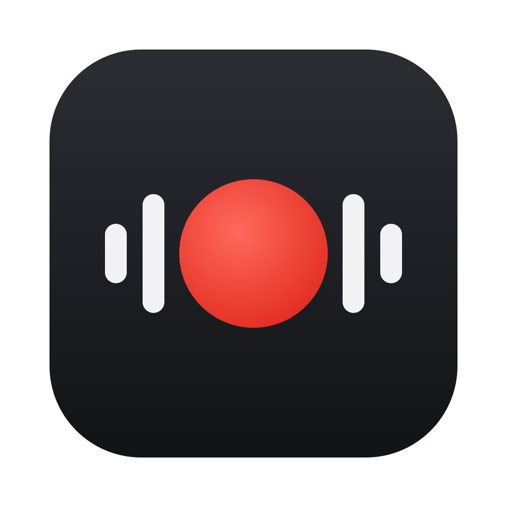
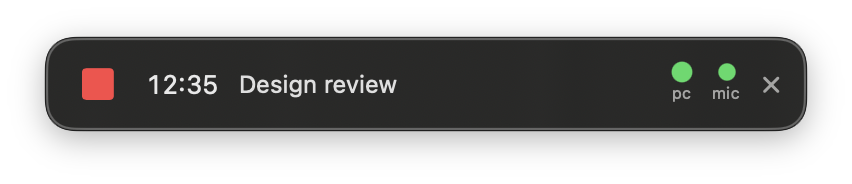
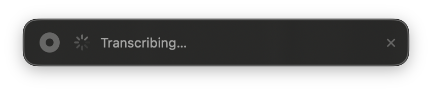
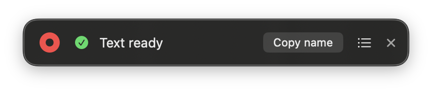

<p align="center"></p>

# MeetRec

A small floating panel for macOS that records a meeting (computer audio and your microphone) and turns it into text on your own machine. No bot joins the call, nothing leaves your Mac.







## What it does

- The panel floats over every space, can be dragged anywhere, and is excluded from screenshots, recordings and screen shares, so the other people on the call never see it.
- **Record** creates a folder named after the start time (`2026-11-11-1436`, plus the meeting name if you typed one) and saves `system.mov` (what the computer played) and `mic.mov` (your voice), then mixes them into `audio.m4a`.
- **Transcribe** writes `transcript.txt` (everyone) and `transcript-mic.txt` (your microphone only) into the same folder, locally with [mlx-whisper](https://github.com/ml-explore/mlx-examples/tree/main/whisper).
- **Copy name** puts `meeting: <folder name>` on the clipboard, ready to paste to an AI agent that reads the transcript and files your notes.
- The list button shows every earlier meeting. Picking one copies its name, and loads it for transcription if it has no text yet. The same list deletes a recording (to the Trash), opens the recordings folder, and changes where new recordings go.
- The x stops and saves a running recording, then closes the app.

## Requirements

- macOS 15 or later on Apple Silicon (mlx-whisper runs on the Apple GPU)
- Xcode 16 or the Command Line Tools with Swift 6 (`xcode-select --install`)
- [`ffmpeg`](https://ffmpeg.org) and [`uv`](https://docs.astral.sh/uv/)

```sh
brew install ffmpeg uv
```

## Run it

```sh
git clone https://github.com/lschiavini/meetrec.git
cd meetrec

# 1. Config: where recordings go, which Whisper model, words to expect
mkdir -p ~/.config/meetrec
cp config.example.json ~/.config/meetrec/config.json

# 2. Build MeetRec.app, copy it to /Applications and launch it
./scripts/build-app.sh --install
```

Without `--install` the app is built to `build/MeetRec.app` and nothing is copied.

The first recording asks for two permissions: **Screen & System Audio Recording** (that is how macOS hands out computer audio; no video is kept) and **Microphone**. The first transcription downloads the Whisper model (over 1 GB for `whisper-large-v3-turbo`), so it takes longer than the ones after it.

If you have a code-signing identity in your keychain, the build script signs with it so the permissions survive rebuilds. Otherwise it signs ad hoc and macOS asks again after each rebuild. Set `MEETREC_SIGN_IDENTITY` to pick a specific identity.

## Config (`~/.config/meetrec/config.json`)

| Key | Meaning |
|---|---|
| `recordingsDir` | Where recording folders go (default in the example: `~/Downloads/audio-recordings`) |
| `whisperModel` | Any mlx-whisper model on Hugging Face, e.g. `mlx-community/whisper-large-v3-turbo` |
| `vocabulary` | Names, products and jargon the transcriber should expect, comma separated |

## Command line

```sh
# Transcribe any recording folder, or import and transcribe an audio file from elsewhere
/Applications/MeetRec.app/Contents/Resources/process.sh ~/Downloads/call.m4a

# Record five seconds without the panel and print what was captured (checks permissions)
/Applications/MeetRec.app/Contents/MacOS/MeetRec --selftest /tmp/meetrec-selftest 5

# Regenerate the README screenshots
.build/release/MeetRec --screenshots docs/screenshots
```

Right-click the panel for the Finder folder, the transcript, the log, and Quit.

## How it works

- `Sources/MeetRec/Recorder.swift` captures system audio and the microphone in one ScreenCaptureKit stream (macOS 15 added microphone capture to it) and writes each to its own file with AVFoundation.
- `Sources/MeetRec/Model.swift` holds the panel state and runs `scripts/process.sh` for mixing and transcription.
- `scripts/process.sh` mixes the tracks with ffmpeg, then runs `scripts/transcribe.py` through `uv run`, which installs mlx-whisper on first use.
- `scripts/make-icon.sh` rebuilds `Resources/AppIcon.icns` from the SVG (needs `rsvg-convert`).
